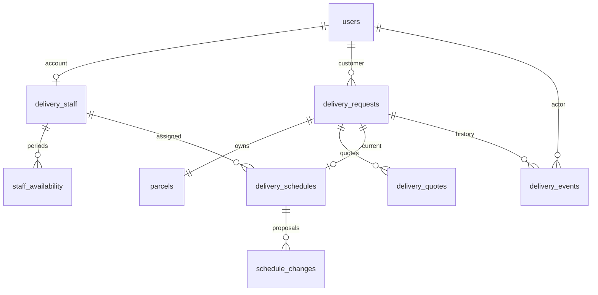

# 数据库设计（A）

H2 文件数据库，九张表，Flyway 管理迁移。SQL 在 `src/main/resources/db/migration/V1__foundation.sql`。不要在合并后改写 V1；新增结构用 V2、V3 等。

## 表与约束

| 表 | 重要字段和关联 |
|---|---|
| users | id、唯一 username、BCrypt password_hash、role、display_name、active |
| delivery_staff | id、唯一 user_id → users、active |
| delivery_requests | customer_id → users、submission_key、original_payload 指纹、联系/地址、status、created_at、version |
| parcels | 唯一 request_id → delivery_requests、description、handling_notes |
| delivery_quotes | request_id、DECIMAL(12,2) amount、pickup_at/delivery_at/expires_at、status、version |
| staff_availability | staff_id、start_at/end_at、AVAILABLE/UNAVAILABLE、version |
| delivery_schedules | 唯一 request_id、staff_id、pickup_at/delivery_at、version |
| schedule_changes | schedule_id、base_schedule_version、提议时间、decision、created_at、version |
| delivery_events | request_id、事件 type、occurred_at、actor_user_id、note |

所有标识均由数据库生成。客户/操作者 ID 是 users.id，配送员 ID 是 delivery_staff.id。amount 为正数且接口拒绝超过两位小数；保存时间为 TIMESTAMP WITH TIME ZONE。时间区间必须 start < end。

账号角色、配送/报价状态、可用类型和事件类型有 CHECK 约束。外键防止孤立记录；一个申请最多一个 Parcel 和一个当前 Schedule。初始化/存取代码维护申请与 Parcel 必须同时存在的约束。用户角色与业务行为的组合规则仍需由服务检查；不能把外键当成完整授权。

## 一致性和并发

- createRequest 把申请与 Parcel 放在一个事务；锁客户账号，串行处理同一客户重复令牌。
- original_payload 是首次提交内容的 SHA-256 指纹，供重试核对；修改申请不会改变指纹。
- version 用于条件更新，失败区分 NOT_FOUND 和 STALE_DATA。
- saveStatusAndEvent 一起更新申请和事件，外键/事件插入失败时回滚。
- inTransaction 复用同一 Spring 事务连接；嵌套 REQUIRED 事务异常不得吞掉。
- lockStaff、lockRequest 使用 SELECT ... FOR UPDATE。线程事务上下文记录已持有锁，并拒绝未按约定加锁的排班写入。
- 加锁顺序人员升序 → 申请升序。事务回滚后锁释放。
- 只有锁住同一人员再查询重叠并保存，才能防止两个并发的新分配同时通过检查。
- findOverlappingSchedules 排除 Delivered/Cancelled 的任务，区间按半开处理；完成任务仍可在 findSchedulesForStaff 中查询。
- 角色会话来自 Spring Security，不存入这九张业务表。当前是单实例本地项目，会话在服务器重启后失效，但业务数据保留。

## 保存与恢复

默认 `./data/delivery.mv.db`。正常关停后备份 data 目录；不要在运行中直接复制数据库文件当作一致备份。数据库文件不进入 Git。

第一次启动迁移数据库并建立本地演示账号。之后 Flyway 验证旧脚本校验和；更改旧脚本会报错，这是防止团队成员悄悄使用不同结构。新增迁移修改结构，禁止启动时执行 DROP TABLE 或自动清库。

## 未包含的表

不创建 Payment、DeliveryReport 或完整员工管理表，因为这些业务不在本次实现范围。业务类与表不强制一一对应。
